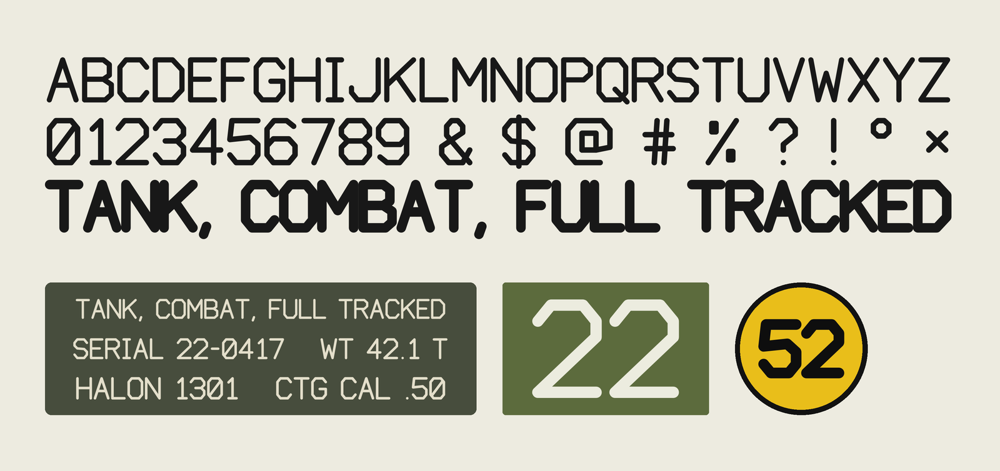
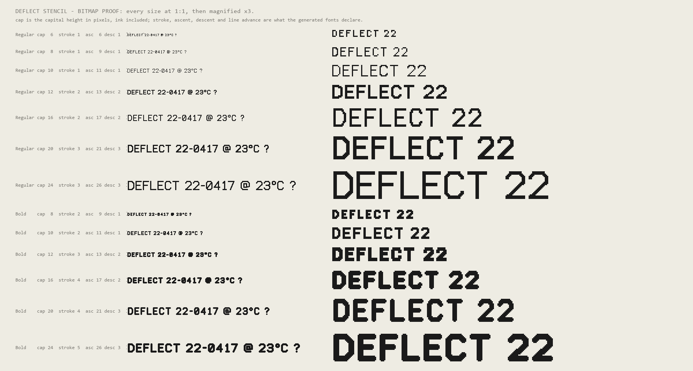
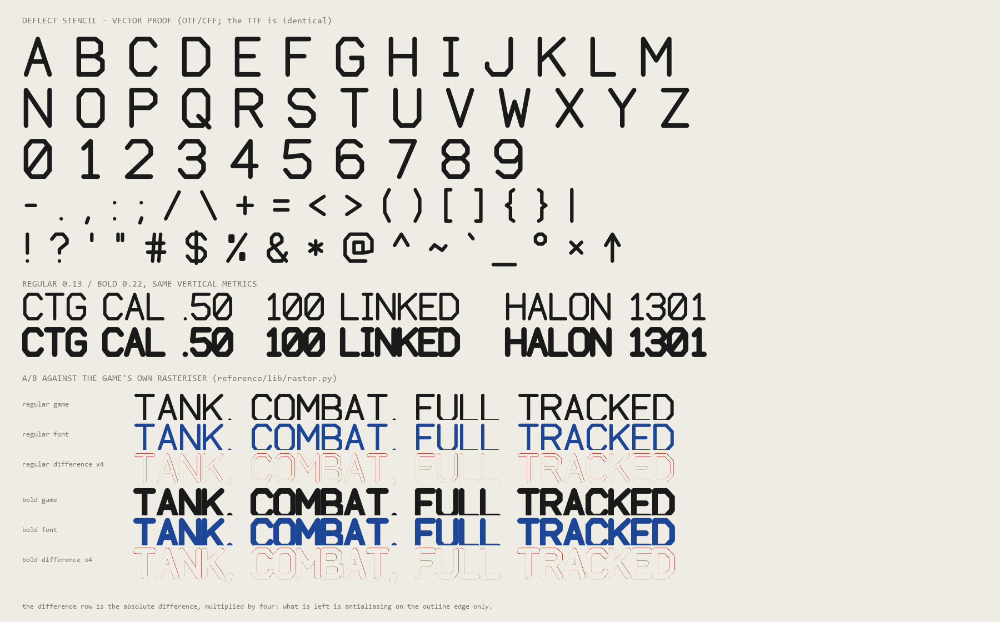

# Deflect Stencil

<p align="center">
  
</p>

The lettering from Deflect's vehicle textures — data plates, gauge numbers, switch
labels, the turret number — built into real fonts. A condensed monoline stencil sans
with round caps and clipped-octagon rounds: slashed zero, serifed I, footed 1, and a
Q whose tail crosses its bowl.

Two weights, **Regular** (stroke 0.13 × cap height) and **Bold** (0.22), as scalable
outlines *and* as hand-fitted pixel fonts for small displays.

Dedicated to the public domain under [CC0 1.0](LICENSE) — the font and the tools that
build it. Use them for anything, commercial or not, with no attribution.

**[Play DEFLECT](https://battleroid.github.io/deflect-font/)** — a top-down tank survival
game built to show the typeface doing its job: every damage number, every RICOCHET, the
whole HUD and the range markings painted on the dirt are set in it. Source in
[`game/`](game/), published to the `gh-pages` branch.

---

## Which file do I want?

| Target | Use |
|---|---|
| Desktop, print, web, design tools | `dist/otf/` (or `dist/ttf/`) |
| SSD1306 / SH1106 mono OLED on an ESP32 | `dist/u8g2/` |
| Colour TFT with Adafruit_GFX, TFT_eSPI, LovyanGFX, Arduino_GFX | `dist/gfx/` |
| LVGL UI — SenseCAP Indicator, ESP32-S3 boards, LVGL 8 or 9 | `dist/lvgl/` |
| LVGL where you want **one** font at any size | `dist/ttf_c/` + `lv_tiny_ttf` |
| Feeding some other tool (bdfconv, lv_font_conv, FontForge) | `dist/bdf/` |

---

## The bitmap sizes

`cap` is the **capital height in pixels, ink included** — ask for 8 and an `E` is
exactly 8 rows tall. `asc`/`desc` are the ink above and below the baseline (`(`, `)`
overshoot the caps; `,` descends). `line` is the line advance the fonts declare.
Regular and Bold at the same `cap` share `line`, so switching weight never moves a
baseline.

| Style | cap | stroke | asc | desc | line | u8g2 B | GFX B | LVGL B |
|---|---|---|---|---|---|---|---|---|
| Regular |  6 | 1 |  6 | 1 |  8 |  836 |  833 |  844 |
| Regular |  8 | 1 |  9 | 1 | 12 | 1095 |  937 |  949 |
| Regular | 10 | 1 | 11 | 1 | 14 | 1290 | 1123 | 1140 |
| Regular | 12 | 2 | 13 | 2 | 17 | 1457 | 1373 | 1398 |
| Regular | 16 | 2 | 17 | 2 | 22 | 2060 | 1799 | 1836 |
| Regular | 20 | 3 | 21 | 3 | 28 | 2348 | 2473 | 2529 |
| Regular | 24 | 3 | 26 | 3 | 34 | 2830 | 3272 | 3352 |
| Bold |  8 | 2 |  9 | 1 | 12 | 1033 |  983 |  996 |
| Bold | 10 | 2 | 11 | 1 | 14 | 1238 | 1154 | 1174 |
| Bold | 12 | 3 | 13 | 2 | 17 | 1327 | 1404 | 1431 |
| Bold | 16 | 4 | 17 | 2 | 22 | 2083 | 1948 | 1989 |
| Bold | 20 | 4 | 21 | 3 | 28 | 2471 | 2514 | 2574 |
| Bold | 24 | 5 | 26 | 3 | 34 | 2909 | 3482 | 3569 |

Byte figures are flash, tables included. There is no Bold below cap 8: the stroke
would round to one pixel and be identical to Regular.



---

## Using it

### u8g2 (mono OLED)

Copy `dist/u8g2/deflect_stencil_u8g2.c` and `.h` into your sketch folder or
component. Arduino compiles `.c` files that sit beside the `.ino`; the header is
`extern "C"`-guarded, so C++ is fine.

```cpp
#include <U8g2lib.h>
#include "deflect_stencil_u8g2.h"

U8G2_SSD1306_128X64_NONAME_F_HW_I2C u8g2(U8G2_R0, U8X8_PIN_NONE);

void setup() {
  u8g2.begin();
  u8g2.clearBuffer();
  u8g2.setFont(deflect_stencil_10);     // cap 10 px; _12b etc. for Bold
  u8g2.drawStr(0, 11, "CTG CAL .50");   // y is the baseline
  u8g2.setFont(deflect_stencil_8);
  u8g2.drawStr(0, 25, "100 LINKED");
  u8g2.sendBuffer();
}
void loop() {}
```

Names are `deflect_stencil_<cap>` and `deflect_stencil_<cap>b`. Link only what you
use — each is its own array, and the linker drops the rest.

### Adafruit_GFX / TFT_eSPI / LovyanGFX / Arduino_GFX

Copy the one header you want out of `dist/gfx/`.

```cpp
#include <TFT_eSPI.h>
#include "DeflectStencil16.h"       // or DeflectStencil16Bold.h

TFT_eSPI tft;

void setup() {
  tft.init();
  tft.setFreeFont(&DeflectStencil16);   // Adafruit_GFX: tft.setFont(&DeflectStencil16)
  tft.setCursor(4, 20);                 // y is the baseline
  tft.print("SERIAL 22-0417");
}
```

Each header defines its own `Bitmaps`/`Glyphs`/`GFXfont` symbols, so include a given
header in one translation unit, as with any Adafruit font.

### LVGL (SenseCAP Indicator and friends)

Add the `dist/lvgl/*.c` you need to your build. They compile against LVGL 8 and
LVGL 9 unchanged.

```c
LV_FONT_DECLARE(deflect_stencil_24);

lv_obj_t *label = lv_label_create(lv_screen_active());
lv_obj_set_style_text_font(label, &deflect_stencil_24, 0);
lv_label_set_text(label, "TANK, COMBAT, FULL TRACKED");
```

In ESP-IDF, list the `.c` files in your component's `SRCS`. In Squareline or EEZ,
drop them in the project's font folder and they appear in the font picker.

### LVGL with real outlines (`lv_tiny_ttf`)

On an ESP32-S3 you have the headroom to rasterise the outline at runtime, which gets
you any size from one ~11 KB array instead of one baked font per size.

```c
#include "deflect_stencil_ttf.h"

lv_font_t *f = lv_tiny_ttf_create_data(
    deflect_stencil_regular_ttf, deflect_stencil_regular_ttf_len, 32);
lv_obj_set_style_text_font(label, f, 0);
```

Enable `LV_USE_TINY_TTF` in `lv_conf.h`. The third argument scales the **em**, not the
cap height (LVGL 9 calls it `font_size`, 8.3 calls it `line_height`): this design sets
the capital at 0.70 em to the stroke's centre line, so 32 gives a capital about 22 px
tall. Multiply the cap height you want by about 1.43.

Below roughly cap 14 px, prefer the baked bitmaps — they are snapped to the pixel
grid and stay crisp where an antialiased outline turns to grey mush.

### Desktop / web

Double-click `dist/otf/DeflectStencil-Regular.otf`, or drop the files in
`%LOCALAPPDATA%\Microsoft\Windows\Fonts`. The `dist/ttf/` build is the same design
with quadratic curves, for anything that prefers TrueType, and ships `.woff2`
alongside it for the web — under 5 KB a weight:

```css
@font-face {
  font-family: 'Deflect Stencil';
  src: url('DeflectStencil-Regular.woff2') format('woff2');
  font-weight: 400;
}
```

### BDF

`dist/bdf/` is the portable source if you need a format not built here:

```bash
bdfconv -f 1 -m "32-255" -n my_font -o my_font.c DeflectStencil-Regular-12.bdf
```

```bash
lv_font_conv --bpp 1 --format lvgl --font DeflectStencil-Regular-12.bdf -r 0x20-0x7E -o out.c --size 15
```

For `lv_font_conv`, `--size` must be the BDF's own `PIXEL_SIZE` (ascent + descent — 15
for Regular-12, printed in the file's `SIZE` line), or it will rescale and blur.

---

## What's in the design

**Glyph set (72 glyphs, 99 codepoints).** The whole of printable ASCII, `0x20`–`0x7E`,
with no gaps, plus `U+00A0` (no-break space), `U+00B0` (degree), `U+00D7` (multiply)
and `U+2191` (up arrow). `a–z` are mapped to the capitals — the game upper-cases its
text and there are no lowercase shapes.

Sixteen of those were never drawn for the game and are new here: `$ & ? @ ; _ [ ] { }
\ | ~ ` ° ×`. They live in `EXTRAS` in `tools/stroke.py`, not in
`reference/lib/font.py`, which stays a byte-identical snapshot of the game's table —
so what came from the game and what did not is visible at a glance. They follow the
same vocabulary: clipped octagons rather than curves, dots as single points, and the
`-0.5`/`6.5` overshoot the parentheses use for the tall marks. The `?` puts its dot
where the `!` does; the `_` spans its entire advance, so a run of them is one
unbroken rule.

Beyond ASCII: the arrow, degree and multiply signs are in the OTF/TTF, the BDF and
the LVGL fonts. The u8g2 fonts carry single-byte encodings, so they have the degree
and multiply signs but not the arrow; the Adafruit_GFX headers are `0x20`–`0x7E` and
have none of the three.

**Where Bold runs out of room.** A 0.22 stroke is 1.32 units of a 6-unit cap, so the
glyphs that need two counters across their width have nowhere to put them at small
sizes. `python tools/check_counters.py` prints exactly where, by counting the
enclosed regions in each rendered glyph:

- **Regular holds everywhere**, down to cap 6. (`@`'s region *count* wanders between
  1 and 4 as pixel snapping pinches its ring into separate pockets — it never fills
  in. `$` drops to one counter at cap 6.)
- **Bold below cap 20** closes up: `@` is solid at caps 8, 12 and 16, `$` at 8 and
  12, `°` at 8, 12 and 16, and `&` keeps one of its two. All four are fine at cap 20
  and 24, and in the outlines at any size.
- `%` is solid at both weights and always was — its two rectangles are 0.6 units wide
  against a 0.78 stroke. That is the game's design, not a defect.

So if you need `@`, `$`, `&` or `°` below cap 20, reach for Regular.

**Cap height.** The source measures the 6-unit capital band to the stroke's *centre
line*, so round caps stand half a stroke proud of it. The outlines keep that: the
centre line sits at 700/1000 em, exactly as in the game, and `OS/2.sCapHeight`
reports the outer edge (746 Regular, 777 Bold). The bitmaps are fitted the other way
— `cap` is the outer ink height, because on a 64-pixel display you want to ask for
eight rows and get eight rows.

**Spacing.** The design advances by `width + 1.3` units with no side bearings, the
caps overhanging into the gap. The fonts split that 1.3 into equal bearings, which
moves a line of text half a gap to the right and changes nothing else. The bitmaps
additionally guarantee at least one blank column between glyphs, which the raw design
does not at small sizes.

**No kerning, no lowercase, no italics.** Slant is a shear in the game; apply it with
a transform if you want it.

Every glyph in both weights, and the outlines checked against the game's own
rasteriser — the difference row is what is left over, which is antialiasing on the
outline edge:



`construction.png` shows each of the game's own glyphs on its unit grid, with the
polyline points and the advance width marked; `specimen.py` regenerates it and
`specimen.png` with the game's rasteriser.

---

## Rebuilding

```bash
python build.py
```

Needs Python 3 with `fonttools`, `skia-pathops`, `Pillow` and `numpy`. It writes
everything into `dist/`, verifies it, and redraws both proof sheets.

To add or drop bitmap sizes, edit `CAPS` at the top of `tools/build_bitmap.py`. To
change the weights, edit `WEIGHTS` in `tools/stroke.py` — the names flow through to
the file names, the OS/2 weight class and the C identifiers.

| | |
|---|---|
| `tools/stroke.py` | glyph table, design-space constants, stroke → outline |
| `tools/build_vector.py` | OTF (CFF) and TTF (glyf) |
| `tools/bitmap.py` | the pixel rasteriser |
| `tools/fmt_bdf.py` `fmt_gfx.py` `fmt_u8g2.py` `fmt_lvgl.py` | one per output format |
| `tools/build_bitmap.py` | drives the bitmap formats |
| `tools/embed_ttf.py` | TTFs as C arrays |
| `tools/verify_vector.py` `verify_bitmap.py` | the checks below |
| `tools/check_counters.py` | where counters close up, by size and weight |
| `tools/proof.py` | the two proof sheets |
| `tools/overview.py` | the specimen at the top of this file |
| `specimen.py` | the game's own specimen and construction sheets |
| `tools/ctest/` | compiles the generated C |
| `reference/` | the game's `font.py` and `raster.py`, unmodified |

### How it is checked

Nothing here is eyeballed.

- **Outlines.** `verify_vector.py` renders every glyph of every built font through
  FreeType and compares it to an exact distance-field evaluation of the original
  polylines — the same rule the game's rasteriser uses. No pixel more than 1.6 px
  from an outline edge disagrees, in either weight, in both OTF and TTF, and every
  advance width matches. The A/B strip on the vector proof sheet shows the same thing
  against `reference/lib/raster.py` itself: what is left in the difference row is
  antialiasing on the edge.
- **Bitmaps.** `verify_bitmap.py` reads every emitted file back off disk the way its
  library parses it — u8g2's run-length bit stream, Adafruit's packed glyph stream,
  LVGL's cmap lookup, BDF's hex rows — and compares every glyph, bounding box and
  advance to a fresh render. All 13 sizes × 4 formats.
- **The u8g2 encoder.** u8g2 ships no encoder for Python, so `fmt_u8g2.py` has one
  written against `csrc/u8g2_font.c`, plus a decoder ported from the same file.
  `test_u8g2_decoder.py` runs that decoder over u8g2's own `u8g2_font_5x7_tr` and
  checks all 95 glyphs against the BDF it was built from; they match exactly. Every
  font we emit is then round-tripped through it before it is written.
- **Counters.** `check_counters.py` floods the background of every rendered glyph and
  counts the regions that never reach the edge, which is what the table above is
  built from. It is a report, not a pass/fail, so `build.py` does not run it.
- **The generated C.** `tools/ctest/compile_check.sh` compiles all of it with
  `-Wall -Wextra` using the ESP cross compiler, against copies of the real
  `GFXglyph`/`GFXfont` and `lv_font_*` structures — the LVGL fonts twice, once for
  LVGL 8 and once for LVGL 9.
